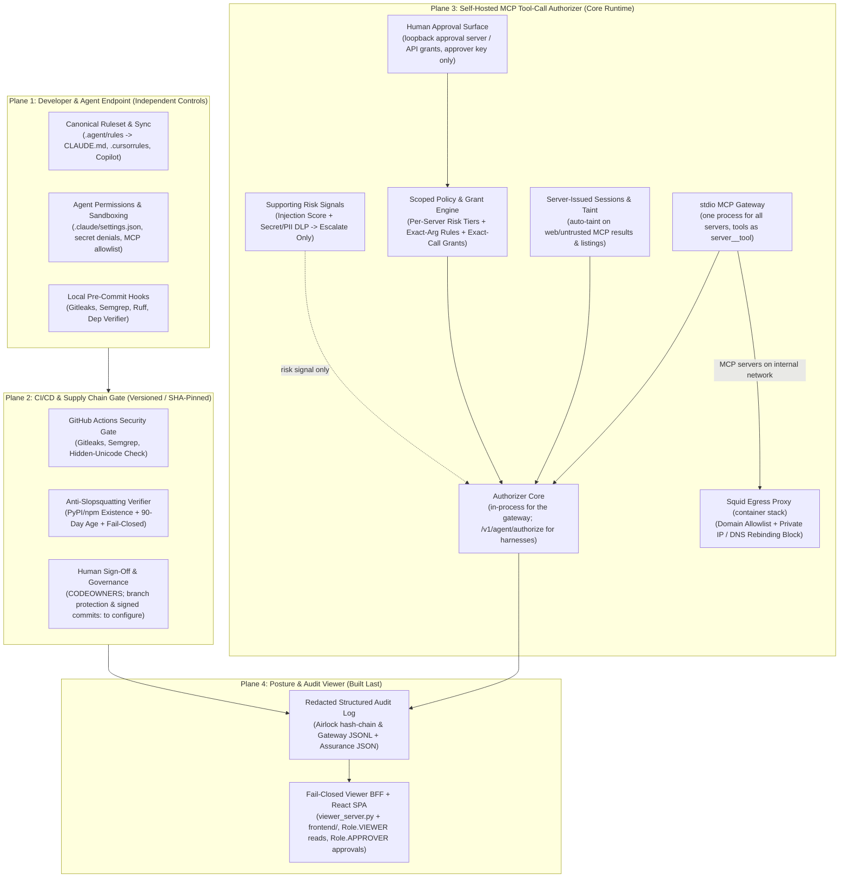

# Mellyn Security — B2B AI Security Engineering Reference Architecture

Mellyn Security is a dual-purpose **AI Security Engineering Portfolio Reference Architecture** and **B2B SMB Security Product** for small-to-medium engineering teams adopting AI coding assistants (Cursor, Claude Code, GitHub Copilot, Antigravity) and deploying MCP-connected AI agents.

---

## 1. Architectural Principles

1. **Authorization-First, Not Detection-First**: Per OWASP LLM01, prompt-injection detection cannot be relied on as a primary security boundary. The runtime core enforces **deterministic tool-call authorization** driven by session provenance (taint), tool risk tiers, scoped argument policies, and human-in-the-loop approvals. Injection/DLP scores act only as risk-escalating signals and audit metadata—never as an allow gate.
2. **Two Complementary Runtime Planes (Airlock Containment + Multi-Server Control Plane)**: Rather than building a fragile multi-provider LLM proxy, Mellyn Security operates at the **MCP / tool-execution boundary** via two complementary runtime planes:
   - **`mcp_airlock` (`src/mcp_airlock/` — Zero-Dependency Stdio Containment Airlock & Red-Team Flight Recorder)**: Wraps a single downstream MCP server over stdio with cryptographic AgBOM tool/manifest/instructions pinning (`mellyn-pin`), deterministic egress/canary detection across obfuscated & encoded variants (`mellyn-bench`), OS-level Automatic Activation Device (AAD) process-tree termination + post-reap confirmation, tamper-evident hash-chained `audit.jsonl` reconstruction (`mellyn-ir`), and an operator `--mode observe` red-teaming harness that also requires the policy's `allow_observe_mode = true`. Installs cleanly with only `pydantic>=2.10.0`.
   - **`mellyn` Control Plane (`backend/mellyn/` — Multi-Server Taint-Tracking Gateway & Human-in-the-Loop Authorizer)**: Runs either as an **HTTP authorization API** (`pip install ".[gateway]"`) or as a **stdio MCP gateway** fronting all downstream servers under one shared session so cross-server taint, risk-tiered rules, exact-call human grants (`Role.APPROVER`), and container Squid egress isolation work across tools and servers.
3. **Self-Hosted First (Zero Prompt Custody)**: v1 deploys as a single self-hosted container or local sidecar inside the customer's own environment. Mellyn Security never holds customer prompts, secrets, or proprietary code on multi-tenant servers.
4. **Independent Defense-in-Depth Controls**: Prompt steering rules, agent permission sandboxes, pre-commit hooks, CI supply-chain gates, and runtime authorization operate as independent layers—compromise or bypass of one layer does not disable the others.

---

## 2. System Architecture Overview



---

## 3. Runtime Tool-Call Authorization Flow

Every tool call the harness submits passes through `Authorizer.authorize(...)`:

0. **Server-Issued Sessions & Two Credentials**: Session IDs come from `POST /v1/sessions`; unknown IDs are denied, so a caller cannot shed taint by inventing a new ID, and a restart (state is in memory) fails closed. The **agent key** (held by the harness) can create sessions, report taint, and request decisions. Only the separate **approver key** (held by the human approval surface) can issue grants, so an agent cannot approve its own calls. Keys are stored as `HMAC-SHA256(pepper, key)` digests.
1. **Provenance & Taint Tracking**: When the authorizer allows a call whose result brings outside content into the session (`http_get`, web fetch/search, or any MCP server not listed as trusted), it taints the session itself. In gateway mode, listing tools or resources from an untrusted server also taints the session, because their descriptions are model-visible text written by that server. Harnesses using the API report other sources they know about (an issue body, a PR comment) through `/v1/sessions/{id}/taint`.
   - **Tool identity is per server.** MCP tools are tiered by `"<server>/<tool>"` (unlisted MCP tools are `HIGH`), and allow rules name their server, so a downstream server cannot borrow a low tier or an allow rule by naming its tool `workspace_read` or `shell_exec`.
   - **Capability bindings.** Hard boundaries attach to arguments, not tool names. A `ToolCapability` says which arguments are paths to read, paths to write, lists of paths, URLs or an argv list, or that the tool is `pure`. Bindings come from `tool_capabilities`, from `server_presets` (`mcp-filesystem`, `mcp-fetch`), or from built-ins for the canonical names; every LOW or MEDIUM tool must have one or the policy fails to load. Unbound (HIGH) tools still get their path-like arguments checked as writes, and `url` arguments are egress-checked on every tool.
   - **Tool pinning.** `pinned_tool_hashes` lets an operator vouch for a server's reviewed `tools/list`; matching listings do not taint the session and changed listings are refused.
   - **Strict arguments.** Arguments must be strict JSON (no NaN/Infinity, string keys only), and rules match by exact JSON type, so `true` never matches `1`.
2. **Tool Risk Classification**:
   - `LOW`: Read-only operations scoped inside the workspace (e.g., `workspace_read`, `git_status`).
   - `MEDIUM`: Local state changes inside the workspace or read-only calls to allowlisted internal/public endpoints (e.g., `workspace_write`, `http_get_allowlisted`).
   - `HIGH`: Shell execution, outbound HTTP to non-allowlisted hosts, file writes outside the workspace, sending external messages, or mutating cloud/payment APIs.
3. **Scoped Policy & Taint-Explosion Mitigation**:
   - Low-risk calls in clean or tainted sessions are allowed and logged (unless explicitly denied).
   - High-risk calls in a **tainted** session are **never auto-allowed** unless matched by an explicit scoped policy rule marked taint-safe **or** a human grant for that exact call.
   - Rules match exactly, never by string prefix: an allow rule lists the exact values (for shell tools, the exact `argv`) and does not match a call with extra arguments; a deny rule can name programs by basename (`rm` matches `/bin/rm -fr`).
   - Shell tools accept only an `argv` list. Command strings and command interpreters (`sh`, `bash`, `cmd`, `powershell`, `env`, ...) are denied outright.
   - Grants are bound to the session, tool, MCP server, and full argument set, expire (default 15 minutes), and are single-use unless the approver sets `max_uses`.
   - Supporting risk signals (prompt-injection score or DLP secret hit) can escalate an `ALLOW` to `REQUIRE_APPROVAL` or `DENY`, but can **never** downgrade a `DENY` or `REQUIRE_APPROVAL` to `ALLOW`.
4. **Network Egress Enforcement**: Application-level URL checks (https only, no IP literals, no userinfo, domain allowlist) run today. In the container stack (`deploy/`), the gateway and its MCP servers run on an internal Docker network whose only route out is a Squid proxy generated from the same allowlist, which blocks private and metadata addresses after DNS resolution. Tools running directly on a developer machine get only the application-level checks.

---

## 4. Repository Directory Structure

```text
V1/
├── .agent/rules/                    # Canonical OWASP AI steering guidelines
├── .claude/settings.json            # Claude Code permission rules (secret denials, approval gates)
├── .github/
│   ├── CODEOWNERS                   # Mandatory owner review on guardrails, CI, configs, and runtime core
│   ├── copilot-instructions.md      # Generated from .agent/rules (verified by sync check)
│   └── workflows/
│       ├── ai-security-gate.yml     # Repo CI gate (Gitleaks, Semgrep, tests, container & Squid harness)
│       └── mellyn-reusable-ai-security-gate.yml # Reusable SHA-pinned workflow_call gate for B2B clients
├── .semgrep/
│   ├── owasp-ai-code-rules.yaml     # Custom SAST rules targeting AI-generated code flaws
│   ├── owasp-ai-code-rules.py       # Semgrep rule test cases (Python)
│   └── owasp-ai-code-rules.tsx      # Semgrep rule test cases (TypeScript/React)
├── backend/
│   └── mellyn/                      # Self-hosted MCP Tool-Call Authorizer & Gateway (Python 3.12+)
│       ├── models.py                # Strict RFC 8259 JSON models, decisions, risk tiers, grants, signals
│       ├── egress.py                # SSRF validator & workspace path/secret/guardrail confinement
│       ├── egress_proxy.py          # Policy-synced Squid forward-proxy config generator (TM-02)
│       ├── policy.py                # Capability bindings, presets, type-strict rules & argv evaluator guard
│       ├── policy_loader.py         # Fail-closed TOML/JSON policy loader
│       ├── authorizer.py            # Core Authorizer: sessions, taint, capabilities, policy, grants & audit
│       ├── audit.py                 # Redacted structured JSONL audit logger
│       ├── credentials.py           # Role-separated agent/approver/viewer keys as HMAC-SHA256(pepper, key) digests
│       ├── legacy_env.py            # Refuses to start while pre-rename variables are still set
│       ├── gateway_config.py        # Strict loader for the MCP gateway's downstream server list
│       ├── mcp_gateway.py           # Single-session multi-server stdio MCP gateway + pinned tool hashes
│       ├── approvals.py             # Pending approvals store + HTTP approval server
│       ├── approval_relay.py        # Narrow host-loopback to internal-network approval relay
│       ├── approve.py               # Approver CLI (python -m mellyn.approve)
│       ├── viewer_server.py         # Fail-closed loopback BFF + SPA (VIEWER reads, APPROVER approvals)
│       └── api.py                   # FastAPI HTTP adapter (/healthz, /v1/sessions, /v1/agent/authorize, grants)
├── config/
│   ├── mellyn-policy.example.toml   # Starter policy for client workspaces
│   ├── mellyn-self-policy.toml      # Dogfooding policy protecting this repository's own core
│   └── mellyn-gateway.example.toml  # Example multi-server MCP gateway config
├── deploy/
│   ├── README.md                    # Self-hosted container & egress proxy deployment guide
│   ├── docker-compose.yml           # Isolated internal network, Squid egress, authorizer & approval relay
│   ├── requirements.lock            # Hash-pinned container runtime Python lockfile
│   ├── requirements-ci-scanners.lock # Hash-pinned CI SAST & lint lockfile (Semgrep + Ruff)
│   ├── requirements-ci-tests.lock   # Hash-pinned CI API test lockfile (FastAPI + Starlette + HTTPX)
│   └── egress/
│       ├── Dockerfile               # Digest-pinned Ubuntu Squid egress image
│       └── squid.conf               # Policy-generated Squid config
├── frontend/                        # Plane 4 Vite + React + TypeScript Posture, Audit & Approval Console
│   ├── package.json                 # Minimal React/Vite manifest
│   ├── package-lock.json            # Pinned npm registry lockfile
│   ├── tsconfig.json                # Strict TypeScript compiler configuration
│   ├── vite.config.ts               # Dev proxy & production bundle configuration
│   ├── index.html                   # SPA entrypoint
│   ├── src/
│   │   ├── main.tsx                 # React 18 root mount
│   │   ├── App.tsx                  # Console layout, mode state & live/offline routing
│   │   ├── types.ts                 # Airlock, Control Plane, Assurance & Approval interfaces
│   │   ├── styles.css               # Dark-mode security console styles
│   │   ├── lib/
│   │   │   ├── parsers.ts           # Client-side SHA-256 chain verifier, JSONL/JSON parsers & URL guard
│   │   │   └── api.ts               # Memory-only X-Mellyn-API-Key HTTP client
│   │   ├── data/
│   │   │   └── sampleData.ts        # Redacted demo dataset
│   │   └── components/
│   │       ├── StatusBadge.tsx
│   │       ├── OverviewTab.tsx      # OWASP/ATLAS Control Assurance matrix & KPIs
│   │       ├── AirlockForensicsTab.tsx # Cryptographic chain status & session timelines
│   │       ├── GatewayAuditTab.tsx  # Control Plane audit stream & taint viewer
│   │       ├── ApprovalsTab.tsx     # Exact-call human grant Approve/Reject workflow
│   │       └── DataSourceDrawer.tsx # Live loopback connection & local file uploader
│   └── tests/
│       └── parsers.test.ts          # Node built-in test suite for parsers & URL validation
├── docs/
│   ├── ARCHITECTURE.md              # This document
│   ├── CLIENT_ONBOARDING.md         # 10-minute B2B client onboarding guide (CI gate & pre-commit pack)
│   ├── OWASP_AI_CODING_SECURITY.md  # OWASP AI-assisted & agentic security synthesis
│   └── THREAT_MODEL.md              # Gateway threat model & automated test traceability matrix
├── examples/
│   ├── adversarial_eval/            # 28-scenario adversarial red-team regression suite (6 families)
│   │   ├── README.md                # Attack catalog & CLI scorecard instructions
│   │   └── run_redteam.py           # Live red-team runner & scorecard emitter
│   ├── airlock_demo/                # Self-contained 5-minute Airlock + Viewer walkthrough
│   │   ├── README.md                # Walkthrough guide & manual CLI commands
│   │   ├── sample_mcp_server.py     # Harmless in-memory MCP stdio demo server
│   │   ├── reviewed_policy.toml     # Pinned & reviewed AgBOM policy (1 allowed tool, 1 blocked tool)
│   │   └── run_demo.py              # Single-command demo runner (allowed + blocked call + viewer)
│   └── observe_redteam/             # Live `--mode observe` multi-turn red-team workflow + viewer parity
│       ├── README.md                # Workflow guide, MCP client JSON snippet & privacy notice
│       ├── sandbox_mcp_server.py    # Sandboxed in-memory MCP server with prompt-injection & canary lure
│       ├── policy.observe.toml      # Pinned observe policy (`allow_observe_mode = true`)
│       ├── policy.enforce.toml      # Pinned enforce counterpart (`allow_observe_mode = false`)
│       └── run_observe_workflow.py  # Multi-turn Observe vs Enforce runner + viewer server
├── scripts/
│   ├── ci_guardrails.py             # Shared checksummed Gitleaks, base-allowlist & baseline-gate CI runner
│   ├── run_conformance_report.py    # Fast-profile conformance runner & JSON/Markdown assurance exporter
│   ├── verify_dependencies.py       # Manifest, lockfile, hash, 90d package & 14d release-cooldown verifier
│   ├── sync_agent_rules.py          # Canonical rules generator & hidden-Unicode smuggling detector
│   └── verify_container_stack.py    # End-to-end Docker build, mount, role, egress & Linux assurance harness
├── src/
│   └── mcp_airlock/                 # Zero-dependency stdio containment airlock, AAD & red-team IR suite
│       ├── __init__.py
│       ├── py.typed                 # PEP 561 strict typing marker
│       ├── core/                    # Canonicalization, schemas, canary redaction & hash-chained audit ledger
│       │   ├── __init__.py
│       │   ├── normalize.py         # Invisible-Unicode stripping, NFKC & exact vs canonical JSON SHA-256
│       │   ├── schemas.py           # Strict frozen Pydantic v2 wire/verdict/audit models
│       │   └── audit.py             # Redact-before-disk hash-chained JSONL ledger + standalone verifier
│       ├── egress/                  # Egress scanning, path/URL guards & benchmark runner (`mellyn-bench`)
│       │   ├── __init__.py
│       │   ├── guards.py            # SSRF URL validator & workspace path/secret/guardrail jail
│       │   ├── scanner.py           # Deterministic canary, API secret & high-entropy scanner
│       │   └── bench.py             # Synthetic precision/recall & latency benchmark CLI (`mellyn-bench`)
│       ├── airlock/                 # Fail-closed stdio proxy, pure policy engine & `mellyn-pin` CLI
│       │   ├── __init__.py
│       │   ├── models.py            # Strict JSON-RPC 2.0 envelopes & AirlockPolicy TOML schemas
│       │   ├── engine.py            # Pure fail-closed AgBOM, path, regex & resource evaluators
│       │   ├── proxy.py             # Bounded stdio proxy, AAD kill switch & operator harness modes
│       │   └── pin_cli.py           # Quarantined starter AgBOM policy & pin generator (`mellyn-pin`)
│       └── ir_lab/                  # Post-incident forensic ledger verification & timeline CLI (`mellyn-ir`)
│           ├── __init__.py
│           ├── verify_chain.py      # Cryptographic hash-chain verifier for audit ledgers
│           └── reconstruct.py       # Chronological session & containment reconstructor (`mellyn-ir`)
├── tests/                           # Security & regression test suites
│   ├── fakes.py                     # Unified recording in-memory MCP FakeDownstream fixture
│   └── conformance/                 # OWASP/ATLAS control validation suite & assurance report recorder
├── .cursorrules                     # Generated from .agent/rules (verified by sync check)
├── .dockerignore                    # Excludes secrets, .git, and .venv from container build context
├── .env.example                     # Placeholder environment configuration
├── .gitattributes                   # Line-ending normalization
├── .gitleaks.toml                   # AI + Cloud secret detection rules (value-based allowlist)
├── .mellyn-allowlist.toml           # Audited, expiring package/version age exemptions
├── .pre-commit-config.yaml          # Local deterministic pre-commit hooks
├── .pre-commit-hooks.yaml           # Exported SHA-pinnable pre-commit hook manifest for client repos
├── CLAUDE.md                        # Claude Code context (imports .agent/rules)
├── Dockerfile                       # Digest- and hash-pinned non-root Mellyn runtime container
└── pyproject.toml                   # Python project manifest
```

---

## 5. B2B SMB Delivery Roadmap

1. **Product 1 (Built & packaged) — Versioned Repo-Hardening Pack**: Packaged as a SHA-pinned pre-commit hook pack (`.pre-commit-hooks.yaml`) and a reusable GitHub Actions workflow (`.github/workflows/mellyn-reusable-ai-security-gate.yml`), so SMB clients receive versioned guardrail updates without copy-paste drift. See [`CLIENT_ONBOARDING.md`](CLIENT_ONBOARDING.md).
2. **Product 2 (Active MVP) — Self-Hosted MCP Tool-Call Authorizer & Gateway**: The capability-bound authorization core, pinned tool-description hashes, HTTP API, stdio MCP gateway, host approval relay, and digest/hash-pinned Docker + Squid egress stack (`deploy/`, continuously verified in CI via `scripts/verify_container_stack.py`) are implemented and tested. Still to build before v1.0 GA: persistent session state and a browser approval UI.
3. **Product 3 (Built & Tested — `frontend/` + `backend/mellyn/viewer_server.py`) — Redacted Posture, Audit & Approval Console**: React + TypeScript SPA backed by a fail-closed loopback HTTP server (read-only `Role.VIEWER` key for evidence, `Role.APPROVER` key only for approvals, `Host` allowlist, `0.0.0.0` only with `--allow-non-loopback`), combining Control Assurance evidence (OWASP LLM/Agentic & MITRE ATLAS), cryptographic Airlock `audit.jsonl` verification, gateway taint/audit logs, and live human approval actions.
