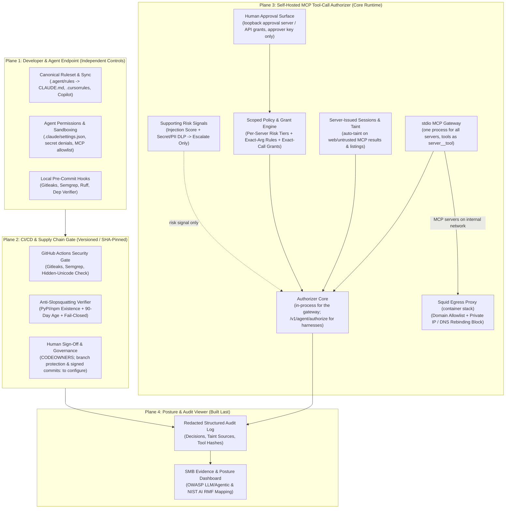

# Mellyn Security — B2B AI Security Engineering Reference Architecture

Mellyn Security is a dual-purpose **AI Security Engineering Portfolio Reference Architecture** and **B2B SMB Security Product** for small-to-medium engineering teams adopting AI coding assistants (Cursor, Claude Code, GitHub Copilot, Antigravity) and deploying MCP-connected AI agents.

---

## 1. Architectural Principles

1. **Authorization-First, Not Detection-First**: Per OWASP LLM01, prompt-injection detection cannot be relied on as a primary security boundary. The runtime core enforces **deterministic tool-call authorization** driven by session provenance (taint), tool risk tiers, scoped argument policies, and human-in-the-loop approvals. Injection/DLP scores act only as risk-escalating signals and audit metadata—never as an allow gate.
2. **MCP Gateway as the Integration Choke Point**: Rather than building a fragile multi-provider LLM proxy, Mellyn Security belongs at the **MCP / tool-execution boundary** where agent actions actually happen. It runs in two modes: an **HTTP authorization API** that a custom agent harness calls before each tool call (it only protects harnesses that call it), and a **stdio MCP gateway** that an MCP client launches in place of its servers, which puts the authorizer in the data path. One gateway process fronts all of a client's servers so that taint and approvals are shared across them. The client must be configured to reach its servers only through the gateway.
3. **Self-Hosted First (Zero Prompt Custody)**: v1 deploys as a single self-hosted container or local sidecar inside the customer's own environment. Mellyn Security never holds customer prompts, secrets, or proprietary code on multi-tenant servers.
4. **Independent Defense-in-Depth Controls**: Prompt steering rules, agent permission sandboxes, pre-commit hooks, CI supply-chain gates, and runtime authorization operate as independent layers—compromise or bypass of one layer does not disable the others.

---

## 2. System Architecture Overview



---

## 3. Runtime Tool-Call Authorization Flow

Every tool call the harness submits passes through `Authorizer.authorize(...)`:

0. **Server-Issued Sessions & Two Credentials**: Session IDs come from `POST /v1/sessions`; unknown IDs are denied, so a caller cannot shed taint by inventing a new ID, and a restart (state is in memory) fails closed. The **agent key** (held by the harness) can create sessions, report taint, and request decisions. Only the separate **approver key** (held by the human approval surface) can issue grants, so an agent cannot approve its own calls. Keys are stored as `HMAC-SHA256(pepper, key)` digests.
1. **Provenance & Taint Tracking**: When the authorizer allows a call whose result brings outside content into the session (`http_get`, web fetch/search, or any MCP server not listed as trusted), it taints the session itself. In gateway mode, listing tools or resources from an untrusted server also taints the session, because their descriptions are model-visible text written by that server. Harnesses using the API report other sources they know about (an issue body, a PR comment) through `/v1/sessions/{id}/taint`.
   - **Tool identity is per server.** MCP tools are tiered by `"<server>/<tool>"` (unlisted MCP tools are `HIGH`), and allow rules name their server, so a downstream server cannot borrow a low tier or an allow rule by naming its tool `workspace_read` or `shell_exec`.
   - **Capability bindings.** Hard boundaries attach to arguments, not tool names. A `ToolCapability` says which arguments are paths to read, paths to write, lists of paths, URLs or an argv list, or that the tool is `pure`. Bindings come from `tool_capabilities`, from `server_presets` (`mcp-filesystem`, `mcp-fetch`), or from built-ins for the canonical names; every LOW or MEDIUM tool must have one or the policy fails to load. Unbound (HIGH) tools still get their path-like arguments checked as writes, and `url` arguments are egress-checked on every tool.
   - **Tool pinning.** `pinned_tool_hashes` lets an operator vouch for a server's reviewed `tools/list`; matching listings do not taint the session and changed listings are refused.
   - **Strict arguments.** Arguments must be strict JSON (no NaN/Infinity, string keys only), and rules match by exact JSON type, so `true` never matches `1`.
2. **Tool Risk Classification**:
   - `LOW`: Read-only operations scoped inside the workspace (e.g., `workspace_read`, `git_status`).
   - `MEDIUM`: Local state changes inside the workspace or read-only calls to allowlisted internal/public endpoints (e.g., `workspace_write`, `http_get_allowlisted`).
   - `HIGH`: Shell execution, outbound HTTP to non-allowlisted hosts, file writes outside the workspace, sending external messages, or mutating cloud/payment APIs.
3. **Scoped Policy & Taint-Explosion Mitigation**:
   - Low-risk calls in clean or tainted sessions are allowed and logged (unless explicitly denied).
   - High-risk calls in a **tainted** session are **never auto-allowed** unless matched by an explicit scoped policy rule marked taint-safe **or** a human grant for that exact call.
   - Rules match exactly, never by string prefix: an allow rule lists the exact values (for shell tools, the exact `argv`) and does not match a call with extra arguments; a deny rule can name programs by basename (`rm` matches `/bin/rm -fr`).
   - Shell tools accept only an `argv` list. Command strings and command interpreters (`sh`, `bash`, `cmd`, `powershell`, `env`, ...) are denied outright.
   - Grants are bound to the session, tool, MCP server, and full argument set, expire (default 15 minutes), and are single-use unless the approver sets `max_uses`.
   - Supporting risk signals (prompt-injection score or DLP secret hit) can escalate an `ALLOW` to `REQUIRE_APPROVAL` or `DENY`, but can **never** downgrade a `DENY` or `REQUIRE_APPROVAL` to `ALLOW`.
4. **Network Egress Enforcement**: Application-level URL checks (https only, no IP literals, no userinfo, domain allowlist) run today. In the container stack (`deploy/`), the gateway and its MCP servers run on an internal Docker network whose only route out is a Squid proxy generated from the same allowlist, which blocks private and metadata addresses after DNS resolution. Tools running directly on a developer machine get only the application-level checks.

---

## 4. Repository Directory Structure

```text
V1/
├── .agent/rules/                  # Canonical OWASP AI security ruleset
├── .claude/settings.json          # Claude Code permission rules (secret denials, approval gates)
├── .github/
│   ├── CODEOWNERS                 # Mandatory owner review on guardrails, CI, and auth core
│   ├── copilot-instructions.md    # Generated from .agent/rules (verified by sync check)
│   └── workflows/
│       └── ai-security-gate.yml   # SHA-pinned CI security gate (Gitleaks, Semgrep, tests)
├── .semgrep/
│   ├── owasp-ai-code-rules.yaml   # Custom SAST rules targeting AI-generated code flaws
│   ├── owasp-ai-code-rules.py     # Semgrep rule test cases (Python)
│   └── owasp-ai-code-rules.tsx    # Semgrep rule test cases (TypeScript/React)
├── backend/
│   └── aegis_ai/                  # Self-hosted MCP Tool-Call Authorizer (Python 3.12+)
│       ├── models.py              # Typed requests, decisions, risk tiers, grants, signals
│       ├── egress.py              # SSRF & outbound destination allowlist validator
│       ├── policy.py              # Scoped tool policy engine & taint-aware evaluator
│       ├── authorizer.py          # Core Authorizer: sessions, taint, policy, grants & audit
│       ├── audit.py               # Redacted structured audit logger (no raw secrets/prompts)
│       ├── credentials.py         # Agent / approver API keys as HMAC-SHA256 digests with a pepper
│       ├── policy_loader.py       # Strict, fail-closed TOML/JSON policy loader
│       ├── gateway_config.py      # Strict loader for the gateway's server list
│       ├── mcp_gateway.py         # stdio MCP gateway fronting all downstream servers
│       ├── approvals.py           # Pending approvals + loopback-only approval server
│       ├── approve.py             # Approver CLI (python -m aegis_ai.approve)
│       └── api.py                 # FastAPI HTTP adapter (/v1/sessions, /v1/agent/authorize, grants)
├── config/                        # Example policy and gateway configs (protected from agent writes)
├── docs/
│   ├── ARCHITECTURE.md            # This document
│   ├── THREAT_MODEL.md            # Gateway threat model (STRIDE + OWASP Agentic/LLM)
│   └── OWASP_AI_CODING_SECURITY.md# OWASP Secure Coding with AI synthesis
├── scripts/
│   ├── verify_dependencies.py     # Anti-slopsquatting & 90-day registry age verifier
│   └── sync_agent_rules.py        # Canonical rules generator & hidden-Unicode detector
├── tests/                         # Unit tests (stdlib unittest; API tests skip unless FastAPI is installed)
├── .cursorrules                   # Generated from .agent/rules (verified by sync check)
├── .gitleaks.toml                 # AI + Cloud secret detection rules (value-based allowlist)
├── .pre-commit-config.yaml        # Local deterministic pre-commit hooks
├── CLAUDE.md                      # Claude Code context (imports .agent/rules)
└── pyproject.toml                 # Python project manifest
```

---

## 5. B2B SMB Delivery Roadmap

1. **Product 1 (Built & packaged) — Versioned Repo-Hardening Pack**: The guardrails are packaged as a SHA-pinned pre-commit hook pack (`.pre-commit-hooks.yaml`) and a reusable GitHub Actions workflow (`.github/workflows/mellyn-reusable-ai-security-gate.yml`), so SMB clients receive versioned guardrail updates without copy-paste drift. See [`CLIENT_ONBOARDING.md`](CLIENT_ONBOARDING.md). The reusable workflow has not yet run in a client repository on GitHub.
2. **Product 2 (Active MVP) — Self-Hosted MCP Tool-Call Authorizer**: The authorization core, the HTTP API, and the stdio MCP gateway exist. Still to build before it is a product: persistent session state, pinning of approved tool descriptions, and an approval UI. A digest-pinned container image and a compose stack with a Squid egress proxy exist (`deploy/`) and have been built and run end to end on Docker Desktop.
3. **Product 3 (Later) — Redacted Posture & Evidence Viewer**: Lightweight Next.js UI over real redacted audit logs, providing structured control evidence mapped to OWASP LLM Top 10, OWASP Agentic Top 10, and NIST AI RMF.
