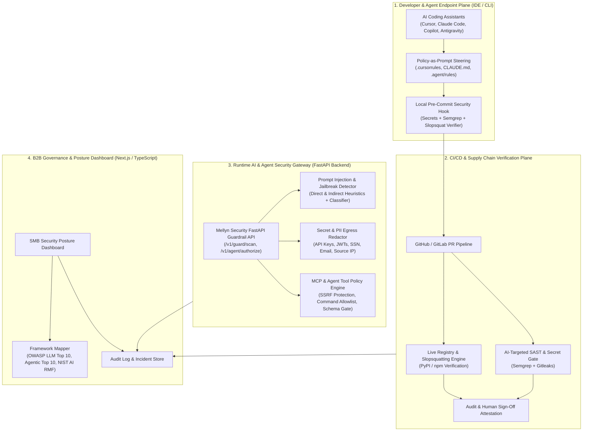

# Mellyn Security — B2B AI Security Engineering Reference Architecture

Mellyn Security is a dual-purpose **AI Security Engineering Portfolio Reference Architecture** and **B2B SMB Product** designed for small-to-medium engineering firms adopting AI coding assistants (Cursor, Claude Code, GitHub Copilot) and deploying LLM/Agentic workflows.

---

## 1. System Architecture Overview



---

## 2. Repository Directory Structure

```text
V1/
├── .agent/rules/                  # Canonical agent ruleset (Antigravity reads it; CLAUDE.md imports it)
├── .claude/settings.json          # Claude Code permission rules (secret files denied)
├── .github/
│   ├── copilot-instructions.md    # GitHub Copilot security constraints
│   └── workflows/
│       └── ai-security-gate.yml   # Automated CI/CD security gate
├── .semgrep/
│   └── owasp-ai-code-rules.yaml   # Custom SAST rules targeting AI-generated code flaws
├── backend/                       # (planned) Python / FastAPI AI Security Engine
│   ├── mellyn/
│   │   ├── api/                   # FastAPI routes (/v1/guard, /v1/supply-chain, /v1/audit)
│   │   ├── core/                  # Typed config (Pydantic Settings), crypto, auth
│   │   ├── engines/
│   │   │   ├── prompt_guard.py    # Direct & indirect prompt injection scanner
│   │   │   ├── secret_dlp.py      # Egress secret & PII detection/redaction
│   │   │   ├── supply_chain.py    # Slopsquatting & dependency risk scorer
│   │   │   └── tool_policy.py     # Agent/MCP tool call validator & SSRF guard
│   │   └── models/                # Strict Pydantic v2 request/response schemas
│   └── tests/                     # Pytest security regression suite
├── frontend/                      # (planned) TypeScript / Next.js B2B SMB Dashboard
├── docs/
│   ├── ARCHITECTURE.md            # System architecture & B2B packaging
│   └── OWASP_AI_CODING_SECURITY.md# OWASP Secure Coding with AI synthesis
├── scripts/
│   ├── verify_dependencies.py     # Anti-slopsquatting & dependency hygiene CLI
│   └── sync_agent_rules.py        # Generates agent rules files from one source; hidden-Unicode check
├── tests/                         # Tests for the scripts above
├── .cursorrules                   # Cursor AI security rules
├── .gitleaks.toml                 # AI + Cloud secret detection rules
├── .pre-commit-config.yaml        # Local deterministic pre-commit hooks
├── CLAUDE.md                      # Claude Code context & security guardrails
└── pyproject.toml                 # Python project & dependency manifest
```

---

## 3. B2B SMB Product Value Proposition

Small firms (10–250 employees) adopt AI coding tools and LLM APIs faster than large enterprises but lack a dedicated AI Security team. Mellyn Security solves three acute SMB pain points:

1. **Zero-Config Secure AI Coding Pack ("Drop-In Repo Hardening")**:
   A 1-command onboarding CLI/template that equips any client repository with OWASP-aligned AI steering rules (`.cursorrules`, `CLAUDE.md`, Copilot instructions), AI-specific Semgrep SAST rules, Gitleaks secret patterns, and slopsquatting protection.
2. **Lightweight Runtime AI & Agent Guardrail API**:
   A self-hosted or managed FastAPI microservice that sits in front of OpenAI/Anthropic/Gemini and MCP tools to block indirect prompt injection, redact leaked credentials/PII before egress, and prevent SSRF/command injection in agent tool calls.
3. **Compliance & Posture Evidence for Enterprise Sales**:
   Maps every scan and runtime policy decision directly to **OWASP LLM Top 10**, **OWASP Agentic Top 10**, and **SOC 2 / ISO 42001 / NIST AI RMF** controls so SMBs can pass enterprise security questionnaires.
