# OWASP AI-Assisted & Agentic Coding Security Synthesis

This document distills guidance from the **OWASP Cheat Sheet Series** ([*Secure Coding with AI*](https://cheatsheetseries.owasp.org/cheatsheets/Secure_Coding_with_AI_Cheat_Sheet.html) and *AI Agent Security*), **OWASP Top 10 for LLM Applications**, **OWASP Top 10 for Agentic Applications**, the **OWASP AI Maturity Assessment (AIMA, built on OWASP SAMM)**, and the **OWASP AI Security & Privacy Guide (AI Exchange)**.

It serves two purposes:
1. **Internal Engineering Standard**: The security baseline governing how this repository is built using AI coding assistants.
2. **B2B Product Foundation**: The threat taxonomy and control matrix that our B2B AI Security product automates for small and medium businesses (SMBs).

---

## 1. The Threat Landscape of AI-Assisted & Agentic Coding

Modern development has shifted from passive autocomplete to **autonomous coding agents** (Antigravity, Claude Code, Cursor, GitHub Copilot, Aider) capable of reading untrusted content, executing shell commands, installing packages, and interacting with external systems via MCP (Model Context Protocol).

| Threat Category | OWASP Mapping | Technical Mechanism | Real-World Impact |
| :--- | :--- | :--- | :--- |
| **1. Classic AppSec Flaws in Generated Code** | OWASP Top 10 (A01-A10) / LLM05 (Improper Output Handling) | Models reproduce insecure patterns from public training sets: missing authorization checks, SQL/Command injection, SSRF, insecure deserialization, and deprecated cryptography (`MD5`, `SHA1`, `Math.random()`). | Exploitable vulnerabilities merged at high velocity due to the **"Speed vs. Review Trap"** (human reviewers rubber-stamping plausible-looking AI PRs). |
| **2. Slopsquatting & Hallucinated Packages** | LLM03 (Supply Chain) / Agentic Supply Chain Poisoning | LLMs deterministically hallucinate plausible package names on PyPI or npm. Attackers register those hallucinated package names with malicious install scripts (`setup.py` / `postinstall`). | Immediate developer workstation or CI runner compromise upon `pip install` or `npm install`. |
| **3. Indirect Prompt Injection via Code & Repos** | LLM01 (Prompt Injection) / Agentic Goal Hijacking | Hidden instructions embedded in GitHub Issues, PR descriptions, READMEs, third-party code comments, stack traces, or MCP server responses read by the coding agent. | Exfiltration of `.env` secrets, silent backdoor insertion, or arbitrary command execution when agents run in "auto-approve" mode. |
| **4. Over-Privileged Agent Execution & Tool Misuse** | LLM06 (Excessive Agency) / Unsafe Tool & Credential Misuse | Coding agents running with the developer's full host privileges, ambient cloud credentials (`~/.aws`, `~/.kube`), and unrestricted network egress. | Destructive local/cloud mutations, lateral movement, or unintended production deployments. |
| **5. Secret Leakage & Data Exposure** | LLM02 (Sensitive Info Disclosure) | Hardcoding API keys in generated snippets, or sending proprietary source code, customer PII, and live credentials to unvetted third-party LLM endpoints. | Credential compromise, IP leakage, and regulatory violations (GDPR, SOC 2, HIPAA). |

---

## 2. OWASP Defense-in-Depth Control Framework

This repository organizes that guidance into a **four-layer defense-in-depth model**. The layering is our own synthesis, not an official OWASP framework; each control maps back to the sources above.

```mermaid
flowchart LR
    subgraph L1["Layer 1: Steering & IDE"]
        R1["Policy-as-Prompt Rules<br/>(.agent/rules, CLAUDE.md, .cursorrules)"]
        R2["Sandboxed Execution &<br/>Human-in-the-Loop Approval"]
    end
    subgraph L2["Layer 2: Local Pre-Commit Gate"]
        P1["Secret Scanning<br/>(Gitleaks)"]
        P2["AI-Targeted SAST<br/>(Semgrep OWASP Rules)"]
        P3["Dependency / Slopsquat<br/>Verifier"]
    end
    subgraph L3["Layer 3: CI/CD & Provenance"]
        C1["Automated Security Workflow"]
        C2["Lockfile Integrity &<br/>Registry Age Checks"]
        C3["Human Owner Attribution"]
    end
    subgraph L4["Layer 4: Runtime Guardrails"]
        G1["Prompt Injection Firewall"]
        G2["PII & Secret Egress Redactor"]
        G3["Agent Tool Policy Engine"]
    end
    L1 --> L2 --> L3 --> L4
```

### Layer 1: Behavioral Steering & Environment Sandboxing
* **Mandatory Security Instructions**: Embed explicit security constraints into every AI assistant context file (`.agent/rules/`, `CLAUDE.md`, `.cursorrules`, `.github/copilot-instructions.md`).
* **Least-Privilege Sandboxing**: Run agent commands inside sandboxed environments without ambient production credentials or unrestricted network access.
* **Treat Repo Inputs as Untrusted**: Never allow an AI agent to automatically execute instructions sourced from external issues, PRs, logs, or unverified MCP servers without human approval.

### Layer 2: Pre-Commit Deterministic Gateways
Because LLMs are probabilistic, security controls must be **deterministic**:
* **Secret Prevention**: Block commits containing cloud credentials, JWTs, or AI provider keys (`sk-`, `sk-ant-`, `AIza`, etc.) using Gitleaks.
* **AI-Focused SAST**: Scan diffs with Semgrep rules specifically tuned for common LLM failure modes (unsafe `eval`/`exec`, shell execution, unsafe deserialization including `torch.load`, SQL string building, weak hashing and randomness, unsanitized `dangerouslySetInnerHTML`). SSRF and missing-authorization checks need data-flow analysis and are planned for the runtime engine and code review rather than pattern rules.
* **Package Existence & Slopsquatting Verification**: Verify every newly added dependency in `pyproject.toml`, `requirements.txt`, or `package.json` for explicit version pinning, canonical registry existence, and package hygiene.

### Layer 3: CI/CD Governance & Accountability
* **The Human is the Author**: An AI assistant cannot be held accountable for the code it produces. Every PR requires human verification and explicit sign-off on security-critical paths (authentication, cryptography, authorization, tool execution, billing).
* **Reproducible Builds** *(next step for this repo)*: Enforce hash-pinned lockfiles (`uv.lock`, `package-lock.json`) and block unverified dynamic installs.

### Layer 4: Runtime Application & Agent Guardrails (Productized for B2B)
When organizations deploy their own LLM features or internal coding/business agents, they require runtime protection:
* **Input/Context Scanning**: Detect direct and indirect prompt injections before they reach the model or tool executor.
* **Egress DLP / Secret Redaction**: Strip API keys, internal tokens, and PII from prompts and agent outputs.
* **Deterministic Tool Policy Enforcement**: Validate every tool/MCP invocation against a strict JSON schema and allowlist before execution.
