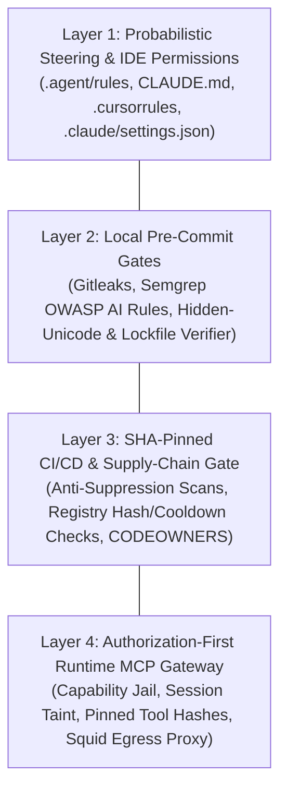

# OWASP AI-Assisted & Agentic Coding Security Synthesis

This document distills guidance from the **OWASP Cheat Sheet Series** ([*Secure Coding with AI*](https://cheatsheetseries.owasp.org/cheatsheets/Secure_Coding_with_AI_Cheat_Sheet.html) and *AI Agent Security*), **OWASP Top 10 for LLM Applications (2025)**, **OWASP Top 10 for Agentic Applications**, the **OWASP AI Maturity Assessment (AIMA, built on OWASP SAMM)**, and the **OWASP AI Security & Privacy Guide (AI Exchange)**.

It serves two purposes:
1. **Internal Engineering Standard**: The security baseline governing how Mellyn Security itself is built using AI coding assistants.
2. **B2B Product Foundation**: The threat taxonomy and deterministic control architecture packaged for small and medium businesses (SMBs).

---

## 1. The Threat Landscape of AI-Assisted & Agentic Coding

Modern development has shifted from passive autocomplete to **autonomous coding agents** (Antigravity, Claude Code, Cursor, GitHub Copilot, Aider) capable of reading untrusted content, executing shell commands, installing packages, and invoking external tools via MCP (Model Context Protocol).

| Threat Category | OWASP Mapping | Technical Mechanism | Real-World Impact |
| :--- | :--- | :--- | :--- |
| **1. Classic AppSec Flaws in Generated Code** | OWASP Top 10 (A01–A10) / LLM05 (Improper Output Handling) | Models reproduce insecure patterns from public training sets: missing authorization checks, SQL/command injection, SSRF, unsafe deserialization, and deprecated cryptography (`MD5`, `SHA1`, `Math.random()`). | Exploitable vulnerabilities merged at high velocity due to the **"Speed vs. Review Trap"** (human reviewers rubber-stamping plausible AI PRs). |
| **2. Slopsquatting & Compromised Releases** | LLM03 (Supply Chain) / Agentic Supply Chain Poisoning | LLMs hallucinate plausible package names on PyPI or npm that attackers pre-register, or pull freshly compromised releases / unverified git tarballs. | Developer workstation or CI runner compromise upon `pip install` or `npm install`. |
| **3. Indirect Prompt Injection & Rules Backdoors** | LLM01 (Prompt Injection) / Agentic Goal Hijacking | Hidden instructions or invisible Unicode (bidi/tag/variation-selector characters) embedded in issues, PRs, instruction files, or MCP tool descriptions/responses. | Exfiltration of `.env` secrets, guardrail tampering, or unauthorized command execution. |
| **4. Over-Privileged Agent Execution & Tool Misuse** | LLM06 (Excessive Agency) / Unsafe Tool & Credential Misuse | Agents running with ambient host credentials (`~/.aws`, `~/.ssh`), unrestricted network egress, or unvetted MCP servers. | Destructive local/cloud mutations, SSRF/DNS-rebinding pivots, or lateral movement. |
| **5. Secret Leakage & Sensitive Data Exposure** | LLM02 (Sensitive Info Disclosure) | Hardcoding API keys in generated code, reading local `.env`/credential stores, or leaking tokens into plaintext logs. | Credential compromise and compliance failures. |

---

## 2. Independent Four-Layer Defense-in-Depth Model

Because language models are probabilistic and prompt injection has no foolproof filter (OWASP LLM01), Mellyn Security treats each layer below as an **independent control** rather than a serial pipeline—bypassing prompt steering at Layer 1 does not weaken pre-commit, CI, or runtime authorization:

### Layer 1: Behavioral Steering & Agent Permission Boundaries
* **Probabilistic Steering Guidelines**: Shared instructions (`.agent/rules/owasp-secure-ai-coding.md` synced to `CLAUDE.md`, `.cursorrules`, and `.github/copilot-instructions.md`) bias coding assistants away from insecure defaults; deterministic gates at Layers 2–4 enforce the rules.
* **IDE Permission Denials**: `.claude/settings.json` denies agent reads of `.env*`, keys, and `~/.aws`/`~/.ssh`/`~/.kube`, and requires human confirmation before package installs, pushes, or guardrail edits.

### Layer 2: Deterministic Local Pre-Commit Gateways
* **Secret Prevention**: Gitleaks scans commits for cloud credentials and AI provider keys (`sk-`, `sk-ant-`, `AIza`, `hf_`, `lsv2_`, etc.) using value-based placeholder allowlisting.
* **AI-Targeted SAST**: Custom Semgrep rules catch `eval`/`exec`, shell execution, unsafe deserialization (`pickle`, `yaml.load`, `torch.load` without `weights_only=True`), SQL string building, weak crypto/randomness, and unsanitized HTML.
* **Hidden-Unicode Check**: `scripts/sync_agent_rules.py --check` blocks invisible format, bidi, tag, variation-selector, and filler codepoints across AI instruction files.

### Layer 3: SHA-Pinned CI/CD & Supply-Chain Verification
* **Registry, Lockfile & Cooldown Verification**: `scripts/verify_dependencies.py --online` checks direct manifests (`pyproject.toml`, `requirements*.txt`, `package.json`) and transitive lockfiles (`requirements*.lock`, `uv.lock`, `package-lock.json`) for registry-only sources, published artifact hashes, 90-day package age, and a 14-day release cooldown, with PR-base-pinned `.mellyn-allowlist.toml` exemptions.
* **Anti-Suppression Reusable Gate**: `.github/workflows/mellyn-reusable-ai-security-gate.yml` checks out caller code and Mellyn's rules side-by-side and ignores `# nosemgrep`, `.semgrepignore`, `# gitleaks:allow`, and `.gitleaksignore`.
* **Human Governance & Reproducible Containers**: `CODEOWNERS` and the `main` branch ruleset protect guardrails; container builds pin base images by SHA-256 digest and Python wheels via `deploy/requirements.lock` (`--require-hashes`).

### Layer 4: Authorization-First Runtime MCP Gateway (`backend/mellyn/`)
* **Capability-Bound Tool Authorization**: `Authorizer` enforces workspace secret/guardrail confinement, HTTPS domain allowlists, and `argv`-only execution (blocking shells and inline `-c`/`-e` evaluators) through explicit `ToolCapability` bindings and presets (`mcp-filesystem`, `mcp-fetch`).
* **Session Taint & Tool-Schema Pinning**: Untrusted external content taints the session so `MEDIUM`/`HIGH` tools require exact-match policy rules or single-call human approvals (`Role.APPROVER`); `pinned_tool_hashes` prevents turn-0 taint on reviewed servers and blocks MCP "rug pulls".
* **Network-Layer Egress Enforcement & Redacted Auditing**: `deploy/docker-compose.yml` isolates the gateway on an `internal: true` network behind a policy-generated Squid proxy (`CONNECT :443`, post-DNS private/metadata IP block, verified in CI against DNS rebinding), while `audit.py` records SHA-256 argument hashes and redacts secrets.
